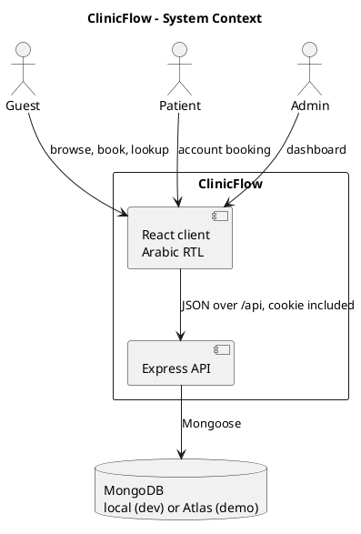
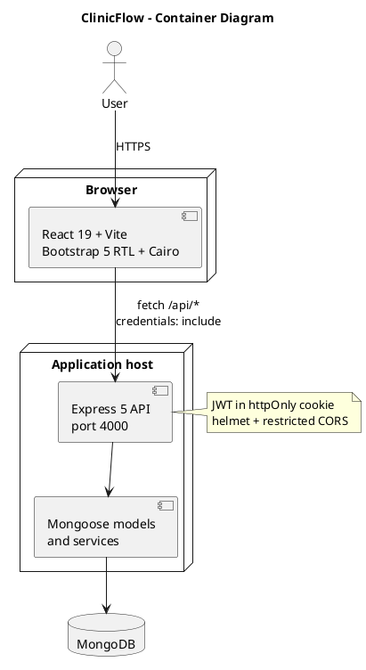
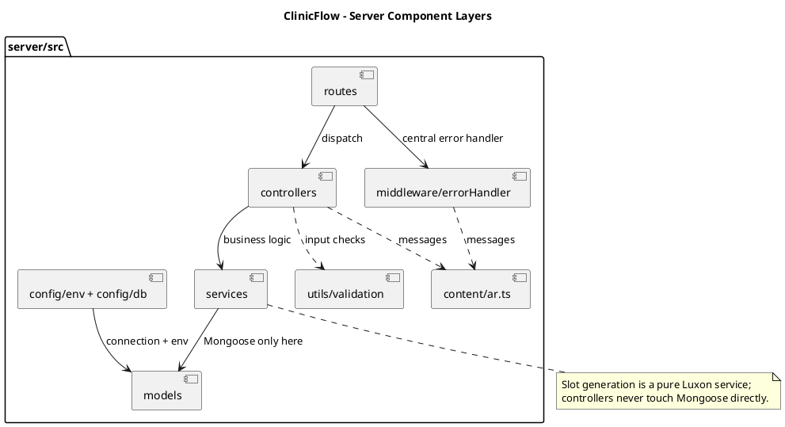
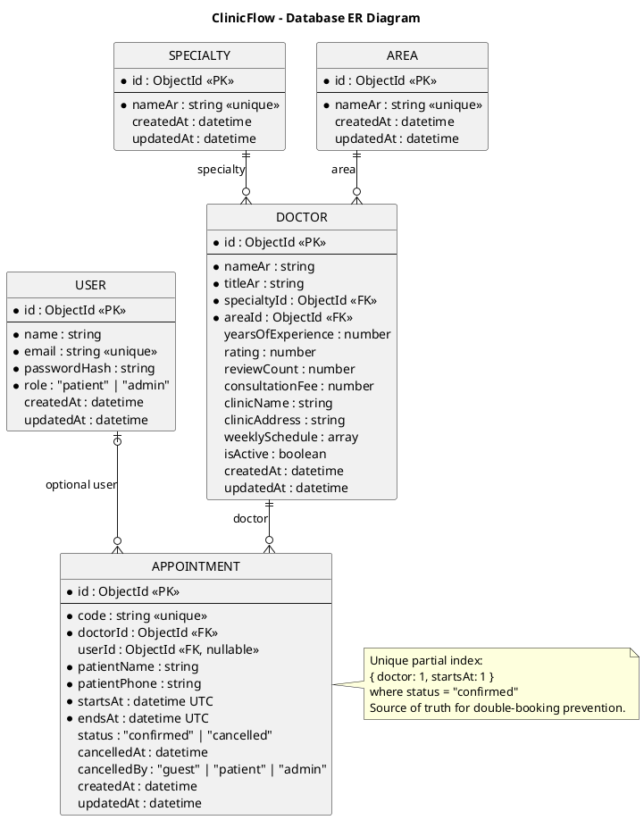
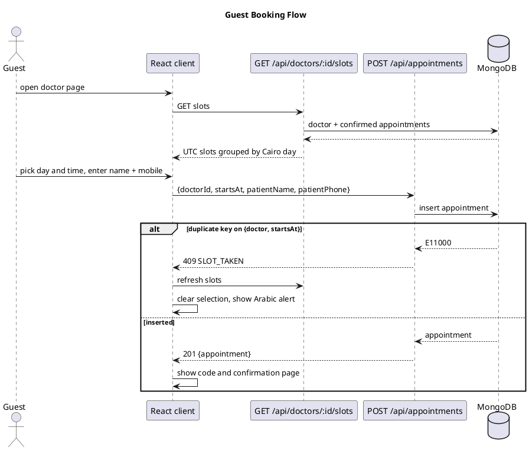
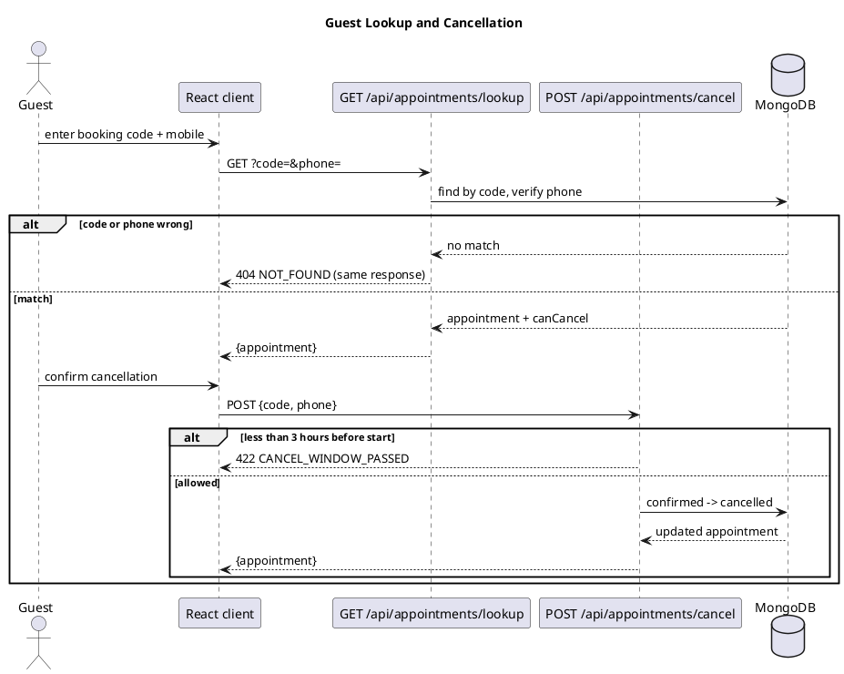
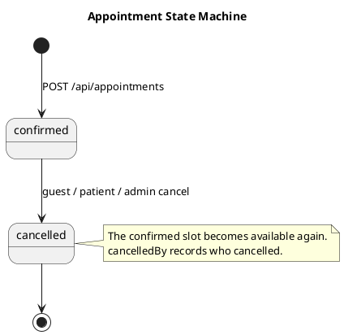

# ClinicFlow Architecture

This document describes **how** ClinicFlow is built. Product behaviour is in [requirements.md](requirements.md); build gates are in [PHASES.md](PHASES.md). PlantUML sources are kept in [`docs/diagrams/`](docs/diagrams/) and repeated below for readability.

## 1. Diagram index

| Diagram | Source | Purpose |
|---|---|---|
| System context | `docs/diagrams/system-context.puml` | Actors and external systems |
| Container architecture | `docs/diagrams/container-architecture.puml` | Browser, API, database boundaries |
| Server components | `docs/diagrams/server-components.puml` | Server layering and dependency direction |
| Database ER | `docs/diagrams/database-er.puml` | Collections, relations, indexes |
| Guest booking sequence | `docs/diagrams/guest-booking-sequence.puml` | Slot selection, booking, conflict handling |
| Cancellation sequence | `docs/diagrams/cancellation-sequence.puml` | Lookup, 404 parity, 3-hour rule |
| Slot generation activity | `docs/diagrams/slot-generation-activity.puml` | Pure Luxon computation |
| Appointment state | `docs/diagrams/appointment-state.puml` | Lifecycle of an appointment |

## 2. System context



There are no external service dependencies: no SMS, email, payments, or third-party identity provider. MongoDB is the only state store.

## 3. Container architecture



- `client/` is a Vite SPA served on port 5173 in development; it owns all Arabic UI strings and RTL presentation.
- `server/` is an Express app on port 4000; all product rules are enforced here.
- `docker-compose.yml` starts both containers from Node 20 Alpine images. No database container is defined because MongoDB is external to the app host.

## 4. Server components



Dependency direction is one-way: routes → controllers → services → models. Cross-cutting helpers (validation, Arabic messages, configuration) are leaves. This keeps controllers thin and makes services independently testable.

## 5. Client structure

| Area | Responsibility |
|---|---|
| `src/main.tsx` | Bootstrap RTL, Cairo font, theme CSS, React root |
| `src/App.tsx` | React Router routes; currently only `/` |
| `src/pages/` | Route-level pages; placeholders until Phases 4 and 5 |
| `src/content/ar.ts` | All Arabic UI strings |
| `src/styles/theme.css` | CSS variables sampled from `design/` screenshots |
| `src/test/setup.ts` | React Testing Library setup |

Phase 3 adds the typed API client, auth context, route guards, layout, and shared components. Phase 4 and 5 fill the pages.

## 6. Data model



`weeklySchedule` entries are `{dayOfWeek, startTime, endTime}` with `dayOfWeek` 0–6 (0 = Sunday). Model-level enforcement of one entry per day, `startTime < endTime`, and 30-minute boundaries is scheduled for Phase 2 with the admin schedule editor; the slot generator currently skips malformed entries.

## 7. Key flows

### 7.1 Guest booking



The booking endpoint, admin endpoints, and the client pages in this sequence are Phase 2 and 4 work; the slot endpoint already exists on `main`.

### 7.2 Guest lookup and cancellation



### 7.3 Slot generation

```plantuml
@startuml slot-generation-activity
title Slot Generation (computed on request)

start
:Read Cairo "today" + next 6 days;

repeat for each date
  :Find weeklySchedule entry for weekday;
  if (no entry?) then (yes)
    :No slots that day;
  else (no)
    :Split [startTime, endTime) into 30-minute slots;
    :Drop slots at or before now;
    :Drop slots with confirmed appointments;
  endif
end repeat

:Group remaining slots by Cairo date label;
:nextAvailableSlot = first remaining slot or null;
stop

@enduml
```

Slots are derived, never stored. `getNextAvailableSlot` is the first remaining slot across the horizon or `null`.

### 7.4 Appointment lifecycle



## 8. Cross-cutting design decisions

| Concern | Decision |
|---|---|
| Time | Luxon with `Africa/Cairo` for logic; UTC `Date` values in MongoDB; ISO UTC strings in API responses |
| Errors | Single shape `{ error: { code, message, fields? } }`; English codes, Arabic messages, `fields` only for validation |
| Auth | JWT in httpOnly `sameSite=lax` cookie; admin role read from verified token, never client input |
| Validation | Shared rules in `server/src/utils/validation.ts`; client mirror added in Phase 3 with identical tests |
| Arabic text | Centralized per app; no inline user-facing strings in components or handlers |
| Testing | Vitest + Supertest + mongodb-memory-server on the server; React Testing Library on the client |
| Configuration | `.env.example` files are authoritative for variable names; secrets are never committed |

## 9. Current implementation status

| Layer | State on `main` |
|---|---|
| Server scaffold, health endpoint, error handler, env/db config | Implemented in Phase 0 |
| Models, validation helpers, Luxon slot generator, seed, public read endpoints | Implemented in Phase 1 |
| Auth, appointments, cancellation, admin API | Planned in Phase 2 |
| Client foundation and all pages | Only Phase 0 placeholder exists; planned in Phases 3–5 |
| QA checklist and Docker end-to-end verification | Planned in Phase 6 |

Known gaps to resolve later: `design/` screenshots are not in the repository (Phase 3 prerequisite); the health endpoint has no failure test (Phase 6 coverage); schedule validators are not yet encoded in the `Doctor` model (Phase 2).
